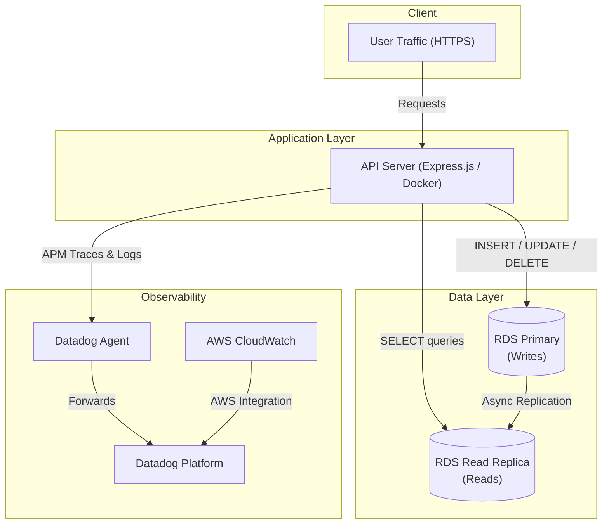

# E-Commerce Cloud Infrastructure

A production-grade cloud infrastructure project that demonstrates how to build, deploy, and monitor a **scalable e-commerce API**. The system leverages containerized microservices, an AWS RDS PostgreSQL database with a read replica for horizontal read scalability, and Datadog for full-stack observability — delivering a resilient, high-performance architecture designed to handle the demands of high-traffic e-commerce workloads.

---

## Architecture Overview

The infrastructure follows a modern cloud-native pattern: a containerized **Node.js/Express** API serves as the application layer, backed by **AWS RDS PostgreSQL** with a primary-replica topology. All write operations (e.g., creating orders) are routed to the **RDS Primary** instance, while read-heavy operations (e.g., browsing products) are directed to the **RDS Read Replica**, ensuring optimal query performance under load. **Datadog** provides end-to-end observability through APM traces, centralized logging, and custom business metrics.



---

## Tech Stack

| Category           | Technology                          |
| ------------------ | ----------------------------------- |
| **Runtime**        | Node.js 20+                         |
| **Framework**      | Express.js                          |
| **Database**       | PostgreSQL (AWS RDS)                |
| **IaC**            | Terraform 1.5+                      |
| **Containerization** | Docker & Docker Compose           |
| **Monitoring**     | Datadog (APM, Logs, Metrics)        |
| **Cloud Provider** | Amazon Web Services (AWS)           |

---

## Project Structure

```
ecommerce-cloud-infra/
├── .env.example            # Template for environment variables
├── .gitignore              # Git ignore rules
├── README.md               # Project documentation (this file)
├── submission.json         # Deployment identifiers & metadata
├── docker-compose.yml      # Multi-container orchestration (API, DB, Datadog Agent)
├── Dockerfile              # Container image for the Node.js API
├── package.json            # Node.js dependencies and scripts
├── src/
│   ├── index.js            # Application entry point & Express server setup
│   ├── db.js               # Database connection pools (writer + reader)
│   ├── routes/
│   │   ├── health.js       # Health check endpoint
│   │   ├── products.js     # Product CRUD routes
│   │   └── orders.js       # Order CRUD routes
│   └── middleware/
│       └── metrics.js      # Custom Datadog metrics middleware
├── infra/
│   ├── main.tf             # Root Terraform configuration
│   ├── variables.tf        # Input variables for Terraform
│   ├── outputs.tf          # Terraform outputs (RDS endpoints, etc.)
│   ├── provider.tf         # AWS provider configuration
│   └── rds.tf              # RDS Primary + Read Replica resources
└── scripts/
    └── seed.sql            # Database seed data for development
```

---

## Prerequisites

Before getting started, ensure you have the following installed and configured:

- **Docker & Docker Compose** — for containerized local development
- **Node.js 20+** — for running the API outside of Docker (optional)
- **AWS Account** — with IAM permissions for RDS, VPC, and CloudWatch
- **Terraform 1.5+** — for provisioning cloud infrastructure
- **Datadog Account** — a [free trial](https://www.datadoghq.com/) is sufficient

---

## Getting Started

### 1. Local Development

```bash
# Clone the repository
git clone https://github.com/your-username/ecommerce-cloud-infra.git
cd ecommerce-cloud-infra

# Create your environment file from the template
cp .env.example .env
# Edit .env and fill in your values (DB credentials, API keys, etc.)

# Build and start all services
docker-compose up -d --build

# Verify the API is running
curl http://localhost:8080/health
# Expected: {"status":"healthy","timestamp":"..."}

# Fetch seeded product data
curl http://localhost:8080/products
```

### 2. Infrastructure Provisioning

```bash
# Navigate to the infrastructure directory
cd infra

# Initialize Terraform (downloads providers & modules)
terraform init

# Preview the infrastructure changes
terraform plan

# Provision the resources on AWS
terraform apply
# Type 'yes' when prompted to confirm

# Note the outputs — you'll need the RDS endpoints
terraform output
```

> [!IMPORTANT]
> Save the `terraform output` values. You'll need the RDS writer and reader endpoints for the next step.

### 3. Deploy to AWS

1. Update your `.env` file with the RDS endpoints from Terraform outputs:
   ```
   DB_WRITER_HOST=<primary-endpoint-from-terraform-output>
   DB_READER_HOST=<replica-endpoint-from-terraform-output>
   ```
2. Configure security groups to allow your application to reach the RDS instances on port `5432`.
3. Deploy the containerized application to your preferred AWS compute service (ECS, EC2, etc.).

### 4. Datadog Setup

```bash
# 1. Sign up at https://www.datadoghq.com/ and obtain your API key.

# 2. Set your API key in the .env file
DD_API_KEY=your_datadog_api_key

# 3. Restart services — the datadog-agent container handles the rest
docker-compose up -d
```

After startup, verify in the **Datadog UI**:
- **APM → Traces**: Request traces for each API endpoint
- **Logs → Search**: Structured application logs with trace correlation
- **Metrics → Explorer**: Custom metrics (`products.requests.total`, `db.query.duration_ms`)

---

## API Endpoints

| Method | Endpoint        | Description            | DB Target      |
| ------ | --------------- | ---------------------- | -------------- |
| GET    | `/health`       | Health check           | —              |
| GET    | `/products`     | List all products      | Read Replica   |
| GET    | `/products/:id` | Get product by ID      | Read Replica   |
| GET    | `/orders`       | List all orders        | Read Replica   |
| POST   | `/orders`       | Create a new order     | Primary        |

---

## Database Read Replica Strategy

The application maintains **two separate connection pools** — one for the RDS Primary (writer) and one for the RDS Read Replica (reader):

- **Writer Pool** (`DB_WRITER_HOST`): Used exclusively for `INSERT`, `UPDATE`, and `DELETE` operations. All transactional writes go through this connection to maintain data integrity.
- **Reader Pool** (`DB_READER_HOST`): Used for all `SELECT` queries. Read-heavy endpoints like product listings and order lookups are directed here, offloading the primary instance and improving read throughput.

This pattern allows the application to **scale reads horizontally** without adding complexity to the application code. RDS handles asynchronous replication from the primary to the replica transparently.

```javascript
// Simplified example from src/db.js
const writerPool = new Pool({ host: process.env.DB_WRITER_HOST });
const readerPool = new Pool({ host: process.env.DB_READER_HOST });

// Route reads to replica, writes to primary
const getProducts = () => readerPool.query('SELECT * FROM products');
const createOrder  = (data) => writerPool.query('INSERT INTO orders ...', data);
```

---

## Monitoring & Observability

The observability stack is built on Datadog's **three pillars**:

| Pillar      | What It Captures                                                        |
| ----------- | ----------------------------------------------------------------------- |
| **Metrics** | System metrics (CPU, memory, I/O), RDS CloudWatch metrics, and custom application metrics |
| **Traces**  | Distributed APM traces across HTTP requests and database queries, enabling latency breakdown and bottleneck identification |
| **Logs**    | Structured JSON logs from the application with automatic trace ID injection for seamless correlation between logs and traces |

All three are correlated in the Datadog UI, allowing you to jump from a slow trace → the related logs → the underlying metric spike in a single click.

---

## Custom Metrics

| Metric Name                  | Type              | Description                                                  |
| ---------------------------- | ----------------- | ------------------------------------------------------------ |
| `products.requests.total`    | Counter           | Tracks the total number of requests to product endpoints. Useful for traffic analysis and rate alerting. |
| `db.query.duration_ms`       | Timer / Histogram | Measures database query execution time in milliseconds. Helps identify slow queries and DB performance regressions. |

Custom metrics are emitted via the Datadog `dd-trace` and `hot-shots` (StatsD) libraries and are automatically collected by the Datadog Agent sidecar container.

---

## Dashboard & Alerts

### Dashboard Widgets

The Datadog dashboard provides a single-pane-of-glass view:

- **Request Rate** — Timeseries graph of `products.requests.total` over time
- **API Latency (p50 / p95 / p99)** — Percentile latency from APM traces
- **DB Query Duration** — Histogram of `db.query.duration_ms` broken down by query type
- **RDS CPU Utilization** — CloudWatch metric for both primary and replica instances
- **Error Rate** — Percentage of 5xx responses over time
- **Active Database Connections** — Connection pool utilization

### Alerts

- **RDS CPU Utilization Monitor**: Triggers a warning when CPU utilization on either the primary or replica instance exceeds **80%** for a sustained period, enabling proactive scaling before performance degrades.

---

## Infrastructure as Code

All cloud resources are defined and managed with **Terraform**, ensuring reproducible, version-controlled infrastructure.

### Terraform Resources

| Resource                      | Description                                      |
| ----------------------------- | ------------------------------------------------ |
| `aws_db_instance` (primary)   | RDS PostgreSQL primary instance for writes        |
| `aws_db_instance` (replica)   | RDS read replica for read-heavy workloads         |
| `aws_db_subnet_group`         | Subnet group spanning multiple AZs for HA         |
| `aws_security_group`          | Firewall rules allowing app-to-database traffic   |
| `aws_db_parameter_group`      | Custom PostgreSQL parameter tuning                |

### Key Terraform Variables

| Variable         | Description                    | Default        |
| ---------------- | ------------------------------ | -------------- |
| `db_username`    | Master database username       | —              |
| `db_password`    | Master database password       | —              |
| `db_instance_class` | RDS instance type           | `db.t3.micro`  |
| `aws_region`     | AWS deployment region          | `us-east-1`    |

---

## Cleanup

To tear down all resources and avoid ongoing AWS charges:

```bash
# Destroy all Terraform-managed infrastructure
cd infra
terraform destroy
# Type 'yes' when prompted

# Stop and remove all Docker containers, networks, and volumes
cd ..
docker-compose down -v
```

> [!CAUTION]
> `terraform destroy` will permanently delete all RDS instances and their data. Ensure you have backups before proceeding.

---

## Design Decisions

- **Read Replica Pattern** — Separating reads from writes at the database level allows the API to handle significantly higher read throughput without scaling the primary instance, a common requirement for e-commerce catalog browsing.
- **Terraform for IaC** — Provides a declarative, auditable, and repeatable way to manage cloud resources, with state tracking and plan previews before any change is applied.
- **Node.js / Express** — Lightweight, non-blocking I/O is well-suited for the high-concurrency, I/O-bound nature of API servers that primarily proxy requests to a database.
- **Docker Compose for Local Dev** — Ensures environment parity between development and production, and makes onboarding as simple as a single command.
- **Datadog for Observability** — Unified platform for metrics, traces, and logs with built-in AWS integrations, reducing tool sprawl and enabling correlated debugging.
- **Separate Connection Pools** — Explicit writer/reader pools in application code provide fine-grained control over query routing without relying on proxy-based solutions.

---

## License

This project is licensed under the [MIT License](LICENSE).

```
MIT License

Copyright (c) 2024 E-Commerce Cloud Infrastructure

Permission is hereby granted, free of charge, to any person obtaining a copy
of this software and associated documentation files (the "Software"), to deal
in the Software without restriction, including without limitation the rights
to use, copy, modify, merge, publish, distribute, sublicense, and/or sell
copies of the Software, and to permit persons to whom the Software is
furnished to do so, subject to the following conditions:

The above copyright notice and this permission notice shall be included in all
copies or substantial portions of the Software.

THE SOFTWARE IS PROVIDED "AS IS", WITHOUT WARRANTY OF ANY KIND, EXPRESS OR
IMPLIED, INCLUDING BUT NOT LIMITED TO THE WARRANTIES OF MERCHANTABILITY,
FITNESS FOR A PARTICULAR PURPOSE AND NONINFRINGEMENT. IN NO EVENT SHALL THE
AUTHORS OR COPYRIGHT HOLDERS BE LIABLE FOR ANY CLAIM, DAMAGES OR OTHER
LIABILITY, WHETHER IN AN ACTION OF CONTRACT, TORT OR OTHERWISE, ARISING FROM,
OUT OF OR IN CONNECTION WITH THE SOFTWARE OR THE USE OR OTHER DEALINGS IN THE
SOFTWARE.
```
